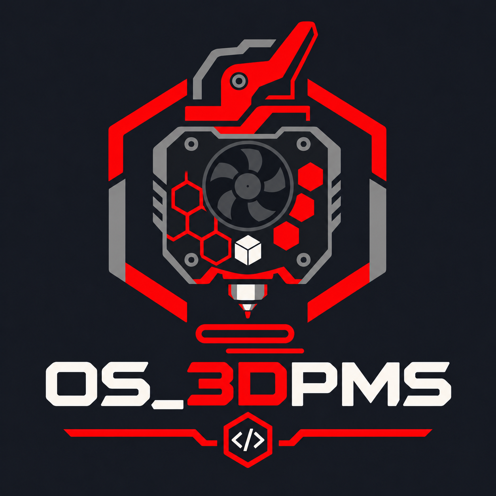

# OS_3DPMS — Open Source 3D Printer Monitoring System



View your printer cameras and print status in one dashboard. Click a camera to
enlarge it, or use the **Mainsail** button for Klipper printer controls. Drag a
`.gcode` file onto a printer to send it and optionally start the print.

**Download:** the Windows package (Python included) is on the
[Releases page](https://github.com/Xanjip32/OS_3DPMS/releases). Install it on the printer-room PC,
add your printers, and the dashboard works on that PC right away, without any account.

**Remote access:** Tailscale gives you the whole dashboard from your phone or laptop anywhere,
privately and at full speed: cameras, Mainsail, Files and Queue. Nothing is opened to the public
internet. Phone alerts while the app is closed come through ntfy, Discord or Telegram.

Works with a mix of printers:

- **Klipper printers** with Mainsail or Fluidd (Moonraker API): Voron, Two Trees Sapphire, RatRig, Creality with Klipper, and others
- **Bambu Lab** P1S / P1P / A1 / X1 in LAN mode

## Features

- Simple navigation: Dashboard, Devices, Queue, Files and Settings in a sidebar (bottom tabs on phones)
- Status counts, search, All / Active / Inactive filters, and camera grid or list view
- Camera cards fill the screen on a desktop and stack on phones
- Click a camera to enlarge it. Use the Mainsail button to open printer controls.
- Drag and drop G-code upload, with an optional "start print" (skipped when the printer is busy)
- Files page: keep G-code and 3MF files on the printer PC (the `files` folder next to
  `config.json`) and send any of them to any printer, with or without starting the print. Shows
  the free disk space. Works on the PC and over Tailscale
- Queue page: line up files per printer (**Add to queue** on the Files page). Each printer runs its
  jobs in order; when it is free (standby, finished or cancelled), its next job shows **Bed is
  clear, start**. Nothing starts by itself. The queue is kept in `queue.json` next to `config.json`
- Devices page: **+ Add printer**, and **Edit** / **Remove** on each printer, on the PC and over
  Tailscale for the accounts listed in Setup → *Allowed Tailscale accounts*
- Queue page: **+ Add job** picks a printer and a file from Files, or uploads a new one
- Remote access over Tailscale, set up from the setup page, with a QR code to open it on a phone
- Print status and progress for Klipper and Bambu printers
- Notifications when a print finishes, fails, pauses or a printer goes offline: pop-ups in the
  dashboard, and on your phone through ntfy, Discord or Telegram
- Per-camera rotation and mirroring
- Hide cameras you do not need on a device (× button), and show them again from the top bar
- Guided setup for adding printers and checking their cameras
- Python standard library only: no packages to install, small attack surface

## Quick start (Windows)

1. Download `OS_3DPMS-Windows-x64.zip` from the
   [Releases page](https://github.com/Xanjip32/OS_3DPMS/releases) and extract it on a PC that can
   reach the printers. Keep the extracted folder in a permanent location, for example `C:\OS_3DPMS`.
2. Double-click **`install.bat`**. The Windows package includes Python. The source download
   can use an existing Python or install it with `winget`. The installer sets OS_3DPMS to start
   at login and opens [Setup](http://127.0.0.1:8079/setup).
3. Click **Find printers on my network** and **Add all**, or choose **Add Klipper** / **Add Bambu**
   and enter the printer IP. Then click **Save printers**.
   Bambu printers also need the LAN access code. Setup checks the printer and shows a camera
   preview as soon as it receives a frame. Click **Open live dashboard** to see your feeds.

To stop: `stop.bat`. To remove: `uninstall.bat`.

If a printer or camera fails to connect, click **Save printers**, then **Check connection**
on that printer in setup. The test runs on the printer-room PC and reports the printer and
camera separately. That PC needs network access to the printer's local address. For Klipper,
enter the HTTP port used by the printer's Mainsail or Fluidd page if it differs from 80.
For Bambu, the printer check tests reachability of its LAN port. The camera check needs
a working feed and LAN access code for the built-in JPEG camera.

### Remote access with Tailscale

Setup opens **Remote access with Tailscale** until it is done:

1. Click **Install Tailscale** (one click), then **Log in to Tailscale**.
2. Click **Publish dashboard**. The first time, Tailscale may ask you to enable HTTPS ("Serve")
   for your tailnet: Setup shows the link, then click Publish again.
3. Setup shows your dashboard link, `https://<this-pc>.<your-tailnet>.ts.net/`, and a QR code.
4. On your phone or laptop: install the [Tailscale app](https://tailscale.com/download), sign in
   with the same account, then scan the QR code (or open the link) and choose **Install app**.

Type the link exactly as Setup shows it: a dot after `.ts.net` breaks the secure connection.
For a link that is easier to remember, rename the PC in Tailscale (admin console → Machines →
*Edit machine name*, or `tailscale set --hostname=os3dpms`) and optionally your tailnet's name
(admin console → DNS), then click **Publish dashboard** again.

### Install the Tailscale dashboard as an app (PC, iPhone, Android)

The dashboard installs like an app: its own window or full screen, with an icon, and no address bar.
Every device needs the Tailscale app connected and signed in to the same account.

- **Windows / Mac (Chrome or Edge):** open the dashboard link, click **Install app** at the top
  (or the install icon in the address bar). It appears in the Start menu and taskbar.
- **Android (Chrome):** open the link, tap **Install app** (or menu ⋮ → *Install app*).
- **iPhone / iPad (Safari):** open the link in **Safari**, tap **Share** (square with arrow),
  then **Add to Home Screen** → **Add**. Other iPhone browsers cannot install it.

If the app shows "Can't reach your printers" or "site can't be reached", open Tailscale and
connect. On iPhone, turn on **VPN On Demand** in the Tailscale app so it stays connected.

### Linux / macOS

```bash
git clone https://github.com/Xanjip32/OS_3DPMS.git && cd OS_3DPMS
python3 run.py --open-setup
```

For optional remote access, install Tailscale and run as a user that may call
`tailscale serve` (`sudo tailscale set --operator=$USER`).

## Printer notes

**Klipper / Mainsail.** The camera URL is read from Moonraker's webcam list, so whatever
provides an HTTP MJPEG stream or a JPEG snapshot works here. Set **Camera URL override**
in setup to use a different HTTP MJPEG or JPEG snapshot URL. If uploads fail with 401, add the printer PC to
`trusted_clients` in `moonraker.conf`, or enter a Moonraker API key on the setup page.

Out of the box, Moonraker lets any device on your network control the printer without a login.
Run `python tools\secure_printers.py` on the printer PC (printers idle) to require a Mainsail
login everywhere: it saves each printer's API key in OS_3DPMS, creates your login, and trusts
only the printer itself (KlipperScreen keeps working). `--undo` puts the old settings back.

**Bambu Lab.** You need the LAN access code (printer screen: Settings → WLAN / Network). The
code changes when LAN mode is switched off and on, so read it again if the camera stops
working. Uploads go to the SD card, so a card must be inserted. The serial number turns on
live status, notifications and remote start: **Find printers** fills it in, and OS_3DPMS also
picks it up from the printer's network announcement when it is left empty. Send `.gcode.3mf`
files exported from Bambu Studio or OrcaSlicer to start prints remotely.
**Check connection** in setup logs in with the access code and says if the printer refuses it.
P1 and A1 printers allow one camera viewer at a time: close Bambu Studio's or Handy's camera
view, or other viewers, while OS_3DPMS shows the camera. Newer firmware may require *LAN Only Mode* / *Developer Mode* for third-party
tools, and future firmware updates may change this.
The built-in camera reader uses the Bambu JPEG feed on port 6000 (P1P, P1S, A1, A1 mini). X1, H2D
and P2S cameras use RTSP on port 322: setup says so, and you can set **Camera URL override** to an
HTTP MJPEG or JPEG snapshot from a camera bridge such as go2rtc.

## Notifications

Set them up in **Phone notifications** on the setup page and click **Send test**. Tapping an
alert opens your dashboard (over Tailscale).

- **Dashboard pop-ups:** click **Enable alerts** at the top of the dashboard.
- **ntfy** (free, no account): install the [ntfy app](https://ntfy.sh), click
  *Make a private topic link* on the setup page, subscribe to that link in the app, and save.
  The topic name works like a password, so keep it private.
- **Discord:** channel settings → Integrations → Webhooks → New webhook → Copy URL.
- **Telegram:** create a bot with @BotFather, send your bot a message, and enter the bot token
  and your chat id (for example from @userinfobot).

Choose which events notify you. "Attach a camera picture" is off by default, because the
picture is then stored by the notification service.

## Configuration

The setup page writes `config.json`. Settings that are only in the file:

| Key | Default | Meaning |
|-----|---------|---------|
| `port` | `8080` | Dashboard port on 127.0.0.1 (published as HTTPS 443) |
| `admin_port` | `8079` | Setup page port on 127.0.0.1 (never published) |
| `max_upload_mb` | `1024` | Largest accepted G-code file |
| `allowed_users` | `[]` | Tailscale logins allowed in; empty = everyone in your tailnet |
| `require_tailscale_identity` | `true` | Refuse requests without a Tailscale user (for example tagged devices) |

Per printer: `webcam_url` (override the camera URL), `rotate` (0/90/180/270),
`flip_horizontal`, `flip_vertical`, `http_port`.

See [`config.example.json`](config.example.json).

## Security

Read [SECURITY.md](SECURITY.md) for the full threat model. In short:

- All listeners bind to `127.0.0.1`. Remote access exists only through `tailscale serve`.
- Remote dashboard requests must carry the Tailscale identity header by default.
  An optional allow-list restricts access to specific accounts.
- The setup page is never published and rejects non-local `Host` headers (DNS rebinding).
  Printers can be changed remotely only by accounts listed in *Allowed Tailscale accounts*.
- Uploads need a same-origin custom header and pass Origin / `Sec-Fetch-Site` checks (CSRF).
- Strict Content-Security-Policy, no inline scripts, `X-Frame-Options: DENY`.
- Secrets are encrypted at rest with Windows DPAPI and never sent to the browser.
- Bambu TLS certificates are pinned on first use.
- Upload size limit, one upload per printer at a time, connection cap and timeouts.
- Every upload, config change and publish is written to `audit.log` with the Tailscale user.

## Development

```bash
python -m unittest discover -s tests -t . -v   # tests use a fake Moonraker printer
python tests/mock_printer.py 9001              # fake printer for UI work
```

Project layout:

```
dashboard/   server code (web.py = HTTP server, klipper.py, bambu.py, cameras.py, tailscale.py, ...)
web/         dashboard and setup pages (HTML/CSS/JS, no build step)
tests/       unit and integration tests, fake printer
scripts/     helper scripts used by the .bat files
```

**Releases:** set `__version__` in `dashboard/__init__.py`, give `CHANGELOG.md` a matching
`## <version>` section, and push a tag `v<version>`. GitHub Actions builds the Windows package
(app + Python), starts it on a clean Windows machine, and publishes the release with that
section as notes. Versions with a suffix such as `-preview.2` become pre-releases.

Contributions are welcome: see [CONTRIBUTING.md](CONTRIBUTING.md).

## Disclaimer

Not affiliated with Bambu Lab, Two Trees, Voron Design, Mainsail, Klipper or Tailscale.
Starting prints remotely is your responsibility: make sure the bed is clear.

## License

[MIT](LICENSE)
